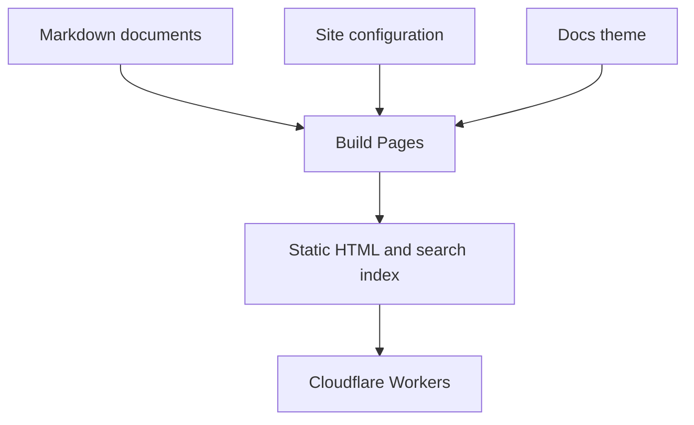

# Markdown Examples

Use this page as a starting point for formatting your own documentation.

## Paragraphs and links

A paragraph can contain **bold text**, *emphasis*, ~~strikethrough~~, and
`inline code`. Keep each paragraph focused on one idea.

Link to a related topic, such as [configuration](../guides/configuration.md),
without making readers search for it.

> A blockquote is useful for an excerpt or a short observation that belongs
> beside the main text.

## Heading hierarchy

Headings divide a page into sections and populate its table of contents.

### A subsection

Use a third-level heading for a topic within a larger section.

#### A smaller detail

A fourth-level heading can organize details without starting a new major section.

## Lists

Unordered lists work well for related items:

- Pages written in Markdown
- Navigation grouped by topic
  - Short introductory guides
  - Detailed reference pages
- Search across the documentation

Ordered lists describe a sequence:

1. Create a Markdown file.
2. Give it a title.
3. Link it from the sidebar.
4. Save and preview the page.

Task list syntax supports checked and unchecked items:

- [x] A checked item
- [ ] An unchecked item

## Alerts

> [!NOTE]
> A page title can come from its first H1 or from frontmatter.

> [!TIP]
> Use source-relative Markdown links so they work in both your editor and the
> published site.

> [!IMPORTANT]
> Menu entries use published URLs; collection entries use Markdown source paths.

> [!WARNING]
> Changing a page's route also changes the address readers use to reach it.

> [!CAUTION]
> Published static files are public. Keep private information out of your pages.

## Tables

| Source file | Published URL | Use |
| --- | --- | --- |
| `index.md` | `/` | Home page |
| `getting-started.md` | `/getting-started` | Introductory guide |
| `markdown-examples/index.md` | `/markdown-examples/` | Directory index page |

Use alignment markers for text and numbers:

| Left aligned | Centered | Right aligned |
| :--- | :---: | ---: |
| Guides | Markdown | 12 |
| Reference | JSON | 4 |
| Examples | Code | 8 |

## Code blocks

Add a language name after the opening fence to enable syntax highlighting.

```json
{
  "site": {
    "title": "My Docs",
    "search": true
  },
  "markdown": {
    "link_output": "clean"
  }
}
```

```js
const pages = [
  { title: 'Getting Started', url: '/getting-started' },
  { title: 'Markdown', url: '/guides/markdown' },
];

for (const page of pages) {
  console.log(page.title, page.url);
}
```

```sh
npm ci
npm run dev
```

Use `txt` for directory trees and other plain text:

```txt
documents/
  index.md
  getting-started.md
  guides/
    markdown.md
  markdown-examples/
    index.md
```

## Mermaid diagrams

A Mermaid fence describes a diagram in text:



Docs loads the Mermaid renderer when a page contains a diagram. If JavaScript
is unavailable, the diagram's source remains readable.

## Literal syntax

Use inline code or a fenced block when you want to show template syntax:
`{{site.title}}`, `{{page.title}}`, and `{{#if page.updated_at_iso}}`.

```html
{{#if page.collection_cursor.next}}
  <a href="{{page.collection_cursor.next.url}}">
    {{page.collection_cursor.next.title}}
  </a>
{{/if}}
```

## Continue reading

See [Navigation](../guides/navigation.md) to arrange these pages into sidebar
groups and a reading order.
